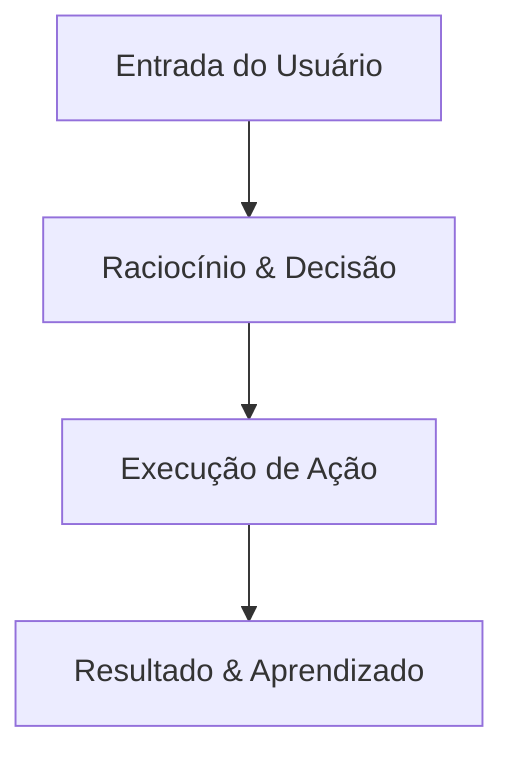

# Midia Dbaocm Hotmart Club

> **Programa:** Imersão Oracle Database com IA — G. A. R de Brito Educacao
> **Módulo:** 01-instalacao-e-fundamentos
> **Status:** 🟡 Rascunho / Em Estruturação
> **Arquivo Base:** `midia-dbaocm-hotmart-club.txt`

---

## 🎯 Objetivos de Aprendizagem
- Compreender os fundamentos apresentados em `Midia Dbaocm Hotmart Club`.
- Relacionar com as práticas e arquiteturas do módulo `01-instalacao-e-fundamentos`.
- Executar a instalação correta do Oracle Database contornando erros de plug-ins e logs
- Compreender os componentes essenciais de infraestrutura de um DBA
- Validar os logs de instalação e dependências do sistema operacional

---

## 🧠 Conceitos Fundamentais e Arquitetura

<!-- SÍNTESE BASEADA NA TRANSCRIÇÃO:
Sejam muito bem-vindos a nossa live de pré-requisitos da nossa inmersão
Oracle, Database e CUNYAR. Eu sou Guilherme Brito, sou fundador da DBOSM
e durante o próximo final de semana, eu vou estar junto com vocês para a gente poder trazer
muita prática, muita mão na massa, sobre Oracle, Database e Inteligência Artificial.
A gente vai trazer vários conceitos, várias visões para quem realmente quer acelerar
com Inteligência Artificial e o Oracle Database, beleza?
Pessoal, que tive a meu vindo aí, digita a cidade onde você está falando, só para
eu poder saber se o áudio está chegando legal, a gente já vai começar aqui a nossa live
de tiraduda, separe suas principais dúvidas, aqui no Zoom, tem uma área de que o
venê de perguntas e respostas, que você pode estar selecionando ali as suas principais dúvidas
sobre a inmersão, sobre Oracle, sobre a que eu vou estar respondendo aqui, quem quiser falar,
no final, vou dar a oportunidade de ter a opção de levantar a mão aqui no Zoom e a gente pode
também te dar essa oportunidade da gente poder fazer um bate-papo, tá bom? E conversar e entender
melhor aquilo que você tá buscando, beleza? Vamos lá, pessoal, para a gente começar aqui o nosso
bate-papo de hoje, eu quero que seja um bate-papo bem leve, uma conversa realmente, tá?
-->

### Diagrama Arquitetural / Fluxo Conceitual

---

## 💻 Implementação Prática & Componentes Técnicos
- **Ferramentas abordadas:** Ver transcrição em `materiais/transcricoes/midia-dbaocm-hotmart-club.txt`.
- **Implementações sugeridas:** Criar laboratório prático em `labs/`.

---

## ⚖️ Trade-offs e Gotchas
- **Atenção:** Documento gerado em modo scaffold offline. Configure a `GEMINI_API_KEY` para síntese automatizada com IA.

---

## 📌 Principais Conclusões
- Nota estruturada pronta para detalhamento técnico.
