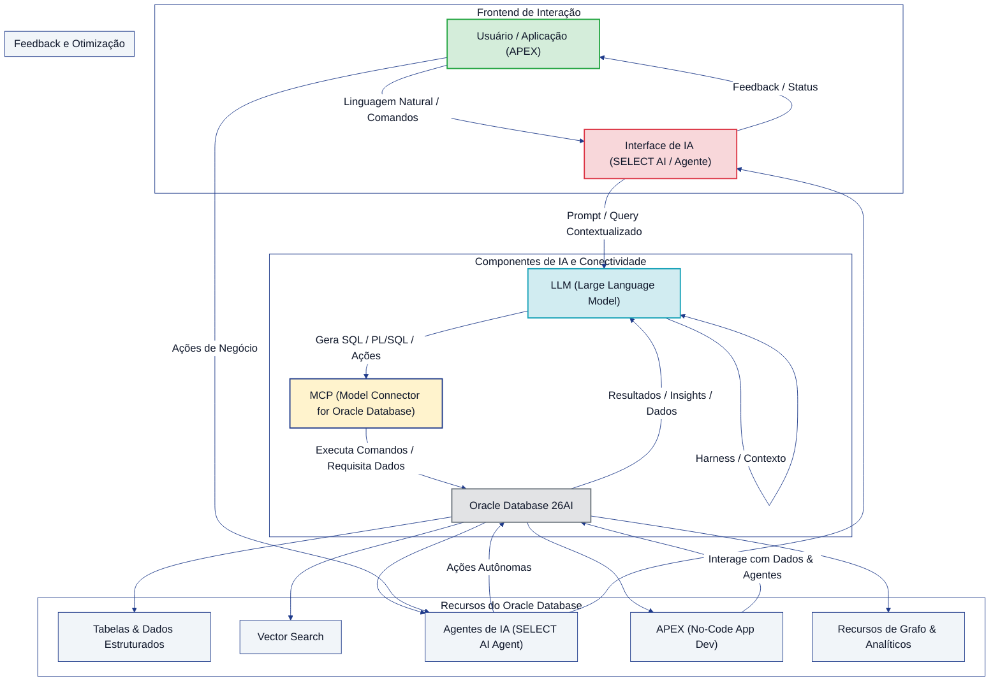
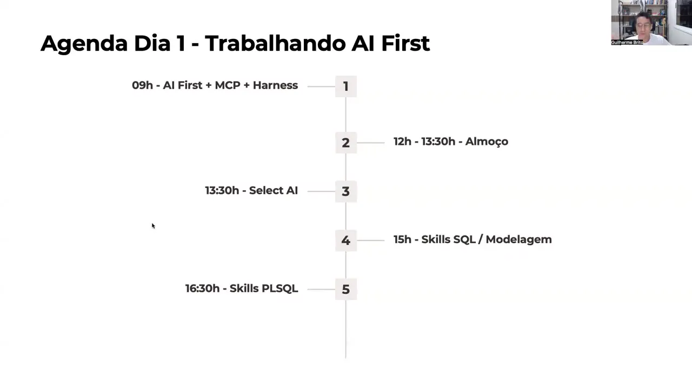

# Aula 01 — Instalação e Fundamentos do Oracle Database

> **Programa:** Imersão Oracle Database com IA — G. A. R de Brito Educacao
> **Módulo:** 01-instalacao-e-fundamentos
> **Status:** Concluído / Documentado
> **Arquivo Base:** `midia-dbaocm-hotmart-club.txt`

---

## 🎯 Objetivos de Aprendizagem & Competências
- **Compreender a Filosofia "AI First":** Assimilar a mudança de paradigma no trabalho de tecnologia, onde a Inteligência Artificial atua como copiloto ou piloto de etapas do desenvolvimento e operação de bancos de dados.
- **Dominar a Configuração de Ambientes Híbridos (On-Premise & Cloud):** Preparar ambientes de desenvolvimento e teste, instalando o Oracle Database 19c localmente e provisionando recursos na Oracle Cloud (OCI Free Tier), incluindo a configuração de ferramentas como Cloud Code e VS Code com extensões OCI/SQL.
- **Executar Instalação e Configuração Essencial:** Instalar o Oracle Database 19c em máquinas virtuais Linux (VirtualBox) e criar contas na Oracle Cloud Free Tier, contornando pré-requisitos e validando logs para garantir um ambiente operacional.
- **Entender a Integração de IA com Oracle Database:** Identificar os métodos e ferramentas para conectar modelos de IA (via MCP) ao Oracle Database, explorando capacidades como SELECT AI (linguagem natural), Skills de IA, Agentes de IA e o Agent Factor (no-code).
- **Analisar o Impacto e Potencial da IA na Engenharia de Dados:** Avaliar como a IA pode acelerar tarefas de DBA e desenvolvimento (10x a 20x mais rápido), otimizar performance, auxiliar na modelagem de dados e expandir a aplicação do Oracle Database para demandas de negócio através de agentes inteligentes.
- **Reconhecer a Importância dos Dados Estruturados para IA:** Compreender que a eficácia da IA é intrinsecamente ligada à qualidade e organização dos dados no Oracle Database, utilizando recursos como Vector Search e Grafos.

---

## 🧠 Glossário e Definições Conceituais Fundamentais
| Conceito / Termo | Definição no Contexto de IA / Engenharia | Aplicação Prática |
| :--- | :--- | :--- |
| **Imersão Oracle Database com IA** | Um formato de aprendizado prático e intensivo, focado em simular desafios do mundo real para aplicar conceitos avançados de Oracle Database e Inteligência Artificial. Diferencia-se de cursos tradicionais pela abordagem "mão na massa" e resolução de problemas. | Capacitação de profissionais para integrar IA em operações e desenvolvimento Oracle, resolvendo problemas de negócio e otimizando tarefas rotineiras. |
| **Oracle Certified Master (OCM)** | Uma certificação de alto nível da Oracle, reconhecida pela sua complexidade e foco em cenários práticos intensivos e extensivos de administração de banco de dados. | Serve como inspiração para a metodologia da imersão, simulando um ambiente de prova e aplicação de conhecimento rigoroso. |
| **AI First** | Uma mentalidade e cultura organizacional onde a Inteligência Artificial é priorizada na concepção de processos, produtos e soluções, atuando como copiloto ou piloto em tarefas que antes eram manuais. | Redução drástica de tempo em tarefas operacionais de DBA/desenvolvimento (e.g., construção de queries, scripts PL/SQL, análise de performance) e automação de fluxos de trabalho. |
| **MCP (Model Connector for Oracle Database)** | Um componente oficial da Oracle para conectar e integrar modelos de Inteligência Artificial diretamente ao Oracle Database, permitindo que o banco de dados interaja com LLMs (Large Language Models). | Permite a execução de comandos SQL ou PL/SQL gerados por IA, consultas em linguagem natural (SELECT AI) e a criação de agentes que operam sobre os dados do Oracle. |
| **Harness (Prompt Engineering)** | A arte e ciência de criar prompts (instruções) eficazes e bem contextualizados para Large Language Models (LLMs) a fim de obter respostas precisas e úteis. | Essencial para extrair o máximo de valor da IA no contexto Oracle, garantindo que as queries geradas por IA, scripts ou análises sejam relevantes e corretas para a tarefa. |
| **SELECT AI** | Funcionalidade do Oracle Database que permite aos usuários fazerem consultas em linguagem natural, que são então convertidas em SQL pela Inteligência Artificial. | Usuários de negócio ou desenvolvedores podem obter dados do banco sem precisar escrever SQL complexo, acelerando a análise e o acesso à informação. |
| **Skills (de IA)** | Instruções ou conjuntos de conhecimentos específicos fornecidos a um modelo de IA para treiná-lo em uma tarefa ou domínio particular (e.g., resolver problemas de SQL, modelagem de dados, PL/SQL). | Criação de "especialistas" em IA que podem auxiliar em tarefas complexas, como otimização de queries, refatoração de código PL/SQL ou geração de schemas de banco de dados. |
| **Agent Engine / Agentes de IA** | Um software autônomo ou semi-autônomo capaz de perceber seu ambiente, tomar decisões e executar ações para atingir um objetivo específico. No Oracle 26AI, podem ser criados diretamente no banco de dados. | Automação de sequências complexas de tarefas, como desenvolvimento de software (SDD), revisão de código, correção de bugs, atendimento de chamados ou criação de propostas comerciais. |
| **RAG (Retrieval Augmented Generation)** | Uma técnica de IA que combina a capacidade de geração de linguagem de um LLM com a recuperação de informações de uma base de dados externa ou documento, fornecendo contexto relevante para a resposta. | Permite que o SELECT AI e outros agentes de IA utilizem informações atualizadas e específicas do ambiente Oracle ou da documentação interna para gerar respostas mais precisas e contextualizadas. |
| **Vector Search** | Um tipo de busca semântica que permite encontrar itens semelhantes em um conjunto de dados com base em suas representações vetoriais (embeddings), em vez de palavras-chave exatas. | Essencial para buscar dados relacionados semanticamente no Oracle Database, permitindo que a IA entenda o *significado* da consulta, não apenas a correspondência de termos. |
| **Agent Factor (No-Code)** | Uma ferramenta no-code fornecida pela Oracle no 26AI que permite a criação e gerenciamento de agentes de IA dentro do Oracle Database sem a necessidade de escrita de código. | Democratiza a criação de soluções baseadas em agentes de IA, permitindo que usuários com menos experiência em programação desenvolvam automações e aplicações inteligentes. |
| **APEX (Oracle Application Express)** | Uma plataforma de desenvolvimento low-code/no-code para criar aplicações web empresariais de forma rápida e eficiente diretamente no Oracle Database. | Quando combinado com IA, o APEX pode acelerar a criação de aplicações em até 20 vezes, permitindo a integração de funcionalidades de IA (agentes, linguagem natural) em interfaces visuais. |
| **SDD (Spec-Driven Development)** | Uma metodologia de desenvolvimento onde as especificações (requisitos) são a principal força motriz para a criação do código. Com IA, a especificação pode ser criada e o código gerado automaticamente. | Acelera o ciclo de desenvolvimento de software, permitindo que a IA traduza especificações em código PL/SQL ou SQL, com revisões e correções automatizadas. |
| **Oracle 26AI** | A versão mais recente do Oracle Database que incorpora funcionalidades nativas de Inteligência Artificial, incluindo a capacidade de criar e rodar agentes de IA diretamente no banco de dados e Vector Search. | Plataforma central para implementar todas as funcionalidades avançadas de IA demonstradas na imersão, oferecendo um ambiente robusto e otimizado para a integração AI/DB. |

---

## 🏗️ Arquitetura, Fundamentos Teóricos e Ciclo de Vida
A imersão "Oracle Database com IA" propõe uma transformação radical na atuação de profissionais de tecnologia, promovendo a adoção de uma cultura **AI First**. Este conceito vai além de simplesmente usar ferramentas de IA; ele redefine a forma de pensar, planejar e executar projetos, onde a Inteligência Artificial se torna um pilar central, atuando como um copiloto para acelerar tarefas ou até mesmo pilotando etapas completas do ciclo de vida de desenvolvimento e operações.

A base teórica enfatiza que, embora a IA seja poderosa, sua inteligência é diretamente proporcional à qualidade e estrutura dos dados que a alimentam. A frase "IA sem dados é burra" encapsula a sinergia necessária entre um robusto sistema de gerenciamento de banco de dados como o Oracle e as capacidades analíticas e generativas da IA. O Oracle Database, sendo o banco de dados mais utilizado no mundo, oferece uma infraestrutura sólida e recursos avançados (como Vector Search, grafo, etc.) para estruturar e otimizar dados para consumo por modelos de IA.

O ciclo de vida de desenvolvimento e operação, sob a ótica da IA, é transformado:
1.  **Definição de Problemas e Estratégia:** A IA pode auxiliar na identificação de gargalos e na formulação de estratégias para automatização.
2.  **Design e Modelagem:** Ferramentas de IA podem propor modelos de dados e arquiteturas otimizadas.
3.  **Desenvolvimento (SDD com IA):** Agentes de IA podem gerar código SQL e PL/SQL a partir de especificações em linguagem natural, acelerando o desenvolvimento e reduzindo erros.
4.  **Testes e Revisão:** A IA pode automatizar testes, identificar bugs e sugerir correções no código.
5.  **Implantação e Operação:** Agentes de IA podem monitorar performance, atender incidentes e automatizar chamados de suporte.
6.  **Análise de Dados e Otimização:** Com SELECT AI e Vector Search, a análise de dados se torna mais acessível e profunda, permitindo otimizações contínuas de performance e uso dos recursos.

### Diagrama Arquitetural & Fluxo de Raciocínio (Mermaid)

Este diagrama representa a integração central da IA com o Oracle Database, mostrando os principais componentes e fluxos de interação discutidos na aula, desde a entrada de prompts até a execução de ações e a geração de insights.



Este diagrama ilustra a interação entre o usuário, os modelos de IA (LLM, MCP) e o Oracle Database. O "Harness" é crucial para fornecer o contexto adequado ao LLM. O Oracle Database 26AI atua como o motor central, aproveitando seus recursos como Vector Search e agentes internos para processar dados e executar ações, retornando resultados e insights. Aplicações desenvolvidas em APEX se beneficiam diretamente dessa integração.

---

## 💻 Passo a Passo Técnico, Live-Coding e Implementação
A imersão é projetada para ser altamente prática, com foco na configuração do ambiente e na execução de desafios. Os participantes serão guiados na preparação de seus postos de trabalho para a integração do Oracle Database com ferramentas de IA.

### Configuração de Ambiente e Pré-requisitos
Para aprofundar na "Imersão Oracle Database com IA", é fundamental ter um ambiente de trabalho configurado. A aula detalha a necessidade de um ambiente híbrido, combinando recursos locais com serviços em nuvem, garantindo flexibilidade e redundância para as práticas.

1.  **Assinatura Cloud Code Pro:**
    *   **Finalidade:** Ferramenta essencial para integração, geração de código e uso de IA, funcionando como um *copiloto* de desenvolvimento.
    *   **Requisito:** Plano "Pro" (aproximadamente 20 dólares/mês ou R$ 92), que pode ser cancelado após um mês de uso para quem deseja apenas acompanhar a imersão. O plano gratuito não oferece acesso a todas as funcionalidades necessárias.
    *   **Instalação (Tutorial fornecido na imersão):**
        *   **Linux:** Comandos específicos para sistemas baseados em Linux.
        *   **Windows:** Utilização do PowerShell ou CMD com comandos de instalação do Cloud Code.
        *   **Inicialização:** Guia passo a passo para iniciar a primeira sessão e integrar com o ambiente de desenvolvimento.
    *   *Observação:* O instrutor menciona que o Cloud Code é o ambiente padronizado da imersão, desaconselhando o uso de outras ferramentas como `codex` para evitar inconsistências e garantir suporte.

2.  **Criação de Conta Gratuita na Oracle Cloud (OCI Free Tier):**
    *   **Finalidade:** Acesso a serviços de nuvem da Oracle, incluindo a criação de "Autonomus Database" para cenários práticos de IA.
    *   **Requisito:** É necessário um cartão de crédito para o cadastro, mas não haverá cobrança para os recursos utilizados no Free Tier (verificar limites de uso da OCI).
    *   **Processo:** Acessar `oracle.com/cloud/free` e seguir o processo de inscrição para criar a conta gratuita.
    *   *Observação:* Mesmo que haja a opção local, o uso da Cloud para alguns cenários é incentivado por explorar recursos específicos da OCI.

3.  **Configuração do VS Code com Extensões:**
    *   **Finalidade:** Ambiente de desenvolvimento integrado para interagir com o Oracle Database e os serviços de IA.
    *   **Extensões Necessárias:**
        *   **Extensão OCI:** Para gerenciamento de recursos na Oracle Cloud diretamente do VS Code.
        *   **Extensão SQL Developer:** Para interagir com bancos de dados Oracle (substituindo o SQL Developer tradicional para padronização).
    *   **Instalação:** Será guiada durante a imersão, com ênfase na simplicidade do processo.

4.  **Instalação Local do Oracle Database 19c (On-Premise):**
    *   **Finalidade:** Prover um ambiente de banco de dados local para práticas, servindo como alternativa ou complemento ao ambiente de nuvem.
    *   **Tecnologia:** Instalação em máquina virtual (VirtualBox) rodando Linux.
    *   **Recursos (Tutorial fornecido na imersão):**
        *   Links para download do Linux.
        *   Links para download do Oracle 19c (arquivo RPM).
        *   Passo a passo detalhado para a instalação do Oracle 19c "do zero" no VirtualBox.
    *   *Recomendação:* Instalar tanto o ambiente local quanto o na nuvem para ter flexibilidade e redundância.

#### Diagrama de Fluxo de Configuração de Ambiente (Mermaid)

Este diagrama representa o processo de configuração do ambiente de desenvolvimento, combinando as etapas locais e em nuvem, garantindo que o participante tenha todas as ferramentas necessárias para a imersão.

```mermaid
%%{init: {'theme':'base','themeVariables':{'darkMode':false,'background':'#FFFFFF','fontSize':'18px','fontFamily':'Arial, Helvetica, sans-serif','primaryColor':'#F1F5F9','primaryTextColor':'#0F172A','primaryBorderColor':'#1E3A8A','secondaryColor':'#E0E7FF','secondaryTextColor':'#0F172A','secondaryBorderColor':'#1E3A8A','tertiaryColor':'#ECFDF5','tertiaryTextColor':'#0F172A','tertiaryBorderColor':'#1E3A8A','mainBkg':'#F1F5F9','textColor':'#0F172A','lineColor':'#1E3A8A','noteBkgColor':'#FEF9C3','noteTextColor':'#0F172A','noteBorderColor':'#1E3A8A','errorBkgColor':'#FEE2E2','errorTextColor':'#0F172A','nodeBorder':'#1E3A8A','nodeTextColor':'#0F172A','clusterBkg':'#FFFFFF','clusterBorder':'#1E3A8A','defaultLinkColor':'#1E3A8A','titleColor':'#0F172A','edgeLabelBackground':'#FFFFFF','actorBkg':'#F1F5F9','actorBorder':'#1E3A8A','actorTextColor':'#0F172A','actorLineColor':'#1E3A8A','signalColor':'#0F172A','signalTextColor':'#0F172A','labelBoxBkgColor':'#F1F5F9','labelBoxBorderColor':'#1E3A8A','labelTextColor':'#0F172A','loopTextColor':'#0F172A','activationBkgColor':'#E0E7FF','activationBorderColor':'#1E3A8A','sequenceNumberColor':'#FFFFFF','labelColor':'#0F172A','altBackground':'#E0E7FF','classText':'#0F172A','attributeBackgroundColorOdd':'#FFFFFF','attributeBackgroundColorEven':'#F1F5F9','sectionBkgColor':'#F1F5F9','altSectionBkgColor':'#FFFFFF','sectionBkgColor2':'#E0E7FF','taskBkgColor':'#E0E7FF','taskBorderColor':'#1E3A8A','taskTextColor':'#0F172A','taskTextLightColor':'#0F172A','taskTextDarkColor':'#0F172A','taskTextOutsideColor':'#0F172A','taskTextClickableColor':'#1E3A8A','activeTaskBkgColor':'#BFDBFE','activeTaskBorderColor':'#1E3A8A','doneTaskBkgColor':'#E2E8F0','doneTaskBorderColor':'#334155','critBkgColor':'#FEE2E2','critBorderColor':'#991B1B','gridColor':'#475569','todayLineColor':'#991B1B','excludeBkgColor':'#F8FAFC','pieTitleTextColor':'#0F172A','pieSectionTextColor':'#0F172A','pieLegendTextColor':'#0F172A','pieStrokeColor':'#1E3A8A','pieOuterStrokeColor':'#1E3A8A','pieOpacity':'1','pieTitleTextSize':'24px','pieSectionTextSize':'18px','pieLegendTextSize':'18px','commitLabelColor':'#0F172A','commitLabelBackground':'#FFFFFF','tagLabelColor':'#0F172A','tagLabelBackground':'#FEF9C3','tagLabelBorder':'#1E3A8A','pie1':'#DBEAFE','cScale0':'#DBEAFE','cScaleLabel0':'#0F172A','cScalePeer0':'#1E3A8A','pie2':'#FEF3C7','cScale1':'#FEF3C7','cScaleLabel1':'#0F172A','cScalePeer1':'#1E3A8A','pie3':'#DCFCE7','cScale2':'#DCFCE7','cScaleLabel2':'#0F172A','cScalePeer2':'#1E3A8A','pie4':'#FCE7F3','cScale3':'#FCE7F3','cScaleLabel3':'#0F172A','cScalePeer3':'#1E3A8A','pie5':'#E0E7FF','cScale4':'#E0E7FF','cScaleLabel4':'#0F172A','cScalePeer4':'#1E3A8A','pie6':'#FFEDD5','cScale5':'#FFEDD5','cScaleLabel5':'#0F172A','cScalePeer5':'#1E3A8A','pie7':'#CCFBF1','cScale6':'#CCFBF1','cScaleLabel6':'#0F172A','cScalePeer6':'#1E3A8A','pie8':'#F3E8FF','cScale7':'#F3E8FF','cScaleLabel7':'#0F172A','cScalePeer7':'#1E3A8A','pie9':'#FEF9C3','cScale8':'#FEF9C3','cScaleLabel8':'#0F172A','cScalePeer8':'#1E3A8A','pie10':'#E2E8F0','cScale9':'#E2E8F0','cScaleLabel9':'#0F172A','cScalePeer9':'#1E3A8A','pie11':'#FFE4E6','cScale10':'#FFE4E6','cScaleLabel10':'#0F172A','cScalePeer10':'#1E3A8A','pie12':'#ECFCCB','cScale11':'#ECFCCB','cScaleLabel11':'#0F172A','cScalePeer11':'#1E3A8A','fillType0':'#DBEAFE','git0':'#DBEAFE','gitBranchLabel0':'#0F172A','gitInv0':'#0F172A','fillType1':'#FEF3C7','git1':'#FEF3C7','gitBranchLabel1':'#0F172A','gitInv1':'#0F172A','fillType2':'#DCFCE7','git2':'#DCFCE7','gitBranchLabel2':'#0F172A','gitInv2':'#0F172A','fillType3':'#FCE7F3','git3':'#FCE7F3','gitBranchLabel3':'#0F172A','gitInv3':'#0F172A','fillType4':'#E0E7FF','git4':'#E0E7FF','gitBranchLabel4':'#0F172A','gitInv4':'#0F172A','fillType5':'#FFEDD5','git5':'#FFEDD5','gitBranchLabel5':'#0F172A','gitInv5':'#0F172A','fillType6':'#CCFBF1','git6':'#CCFBF1','gitBranchLabel6':'#0F172A','gitInv6':'#0F172A','fillType7':'#F3E8FF','git7':'#F3E8FF','gitBranchLabel7':'#0F172A','gitInv7':'#0F172A'}}}%%
flowchart TD
    start("Início: Preparação do Ambiente") --> checkVIP{"Adquiriu VIP?"}

    checkVIP -->|"Sim (recomendado)"| accessRec("Acessar Gravação e Materiais")
    checkVIP -->|"Não"| liveOnly("Participação Apenas ao Vivo")

    accessRec --> sg1["Configuração de Software"]
    liveOnly --> sg1

    subgraph sg1["Configuração de Software e Ferramentas"]
        sg1_1("Instalar VS Code") --> sg1_2("Instalar Extensão OCI")
        sg1_1 --> sg1_3("Instalar Extensão SQL Developer")
        sg1_2 --> sg1_4("Instalar Cloud Code CLI")
        sg1_3 --> sg1_4
        sg1_4 --> sg1_5("Assinar Cloud Code Pro (R$92/mês)")
    end

    sg1_5 --> sg2["Configuração de Base de Dados"]

    subgraph sg2["Configuração de Base de Dados"]
        sg2_1("Criar Conta Oracle Cloud Free Tier") --> sg2_2("Provisionar Autonomous Database (OCI)")
        sg2_1 --> sg2_3("Baixar VirtualBox")
        sg2_3 --> sg2_4("Baixar Linux OS (Ex: Oracle Linux)")
        sg2_4 --> sg2_5("Instalar VM Linux no VirtualBox")
        sg2_5 --> sg2_6("Baixar Oracle Database 19c (RPM)")
        sg2_6 --> sg2_7("Instalar Oracle 19c na VM")
    end

    sg2_2 --> end("Ambiente Preparado para Imersão")
    sg2_7 --> end
```

### Implementação Estruturada de Código
Embora a aula de pré-requisitos não tenha demonstrado live-coding explícito, o instrutor ressalta que a imersão fornecerá todos os **scripts, comandos, skills e agentes** para execução prática. Os tipos de código e abordagens que serão abordados incluem:

-   **SQL:** Construção de queries (manuais e geradas por IA via SELECT AI), junções, subqueries e otimização de performance.
-   **PL/SQL:** Desenvolvimento de código procedimental, criação de "agent engines" e implementação de SDD (Spec-Driven Development) com auxílio de IA.
-   **Agent Definitions:** Scripts e configurações para a criação de agentes de IA dentro do Oracle Database 26AI, utilizando tanto abordagens programáticas quanto a ferramenta no-code Agent Factor.
-   **Prompts para IA (Harness):** Exemplos de como formular prompts eficazes para obter SQL, PL/SQL ou análises específicas dos modelos de IA.
-   **Configurações de Integração:** Scripts para conectar o MCP (Model Connector for Oracle Database) aos LLMs e ao Oracle Database.

```sql
-- Exemplo de uma consulta SELECT AI (conceitual)
-- O usuário faria uma pergunta em linguagem natural, e a IA geraria este SQL:

-- Pergunta do usuário: "Quero saber os 10 clientes com maior volume de vendas no último mês."

SELECT
    c.nome_cliente,
    SUM(v.valor_total) AS volume_vendas
FROM
    clientes c
JOIN
    vendas v ON c.id_cliente = v.id_cliente
WHERE
    v.data_venda >= TRUNC(SYSDATE, 'MM') - INTERVAL '1' MONTH
    AND v.data_venda < TRUNC(SYSDATE, 'MM')
GROUP BY
    c.nome_cliente
ORDER BY
    volume_vendas DESC
FETCH FIRST 10 ROWS ONLY;

-- Comentário Didático: Este é um exemplo de SQL que seria gerado por um agente SELECT AI
-- após uma solicitação em linguagem natural. A IA interpreta a intenção do usuário
-- e constrói a query complexa, incluindo filtros de data, agregações e ordenação.
```

```plsql
-- Exemplo de um bloco PL/SQL para um Agente de IA (conceitual)
-- Um agente pode ser treinado para automatizar um processo de negócio.

DECLARE
    v_order_id NUMBER := 12345;
    v_status VARCHAR2(50);
BEGIN
    -- Obter o status atual do pedido usando uma "Skill" de IA para query de dados
    -- O agente de IA pode ter uma skill para interagir com a tabela de pedidos
    SELECT status_pedido INTO v_status FROM pedidos WHERE id_pedido = v_order_id;

    IF v_status = 'PENDENTE' THEN
        -- Aqui o agente poderia interagir com outras ferramentas ou gerar um e-mail
        -- A IA pode gerar o corpo do e-mail com base em templates e dados do pedido
        DBMS_OUTPUT.PUT_LINE('Pedido ' || v_order_id || ' ainda pendente. Acionando IA para notificação.');
        -- CALL AI_AGENT_NOTIFY('cliente', v_order_id, 'status_pendente'); -- Exemplo conceitual de chamada de agente
    ELSE
        DBMS_OUTPUT.PUT_LINE('Pedido ' || v_order_id || ' com status: ' || v_status);
    END IF;

EXCEPTION
    WHEN NO_DATA_FOUND THEN
        DBMS_OUTPUT.PUT_LINE('Pedido ' || v_order_id || ' não encontrado.');
    WHEN OTHERS THEN
        DBMS_OUTPUT.PUT_LINE('Erro inesperado: ' || SQLERRM);
END;
/

-- Comentário Didático: Este bloco ilustra como um agente de IA dentro do banco de dados
-- poderia executar lógica de negócio complexa. A IA pode ser responsável por partes da lógica,
-- como a geração da mensagem de notificação ou a decisão de qual ação tomar
-- baseada em dados contextuais e regras predefinidas ou inferidas.
```

---

## ⚖️ Análise de Engenharia: Trade-offs, Decisões e Armadilhas (Gotchas)
A adoção da Inteligência Artificial em conjunto com o Oracle Database, embora promissora, envolve considerações importantes de engenharia.

-   **Vantagens & Benefícios:**
    -   **Aumento Exponencial da Produtividade:** A IA pode acelerar tarefas de DBA e desenvolvimento em 10x a 20x, como geração de SQL, PL/SQL, modelagem de dados e resolução de incidentes.
    -   **Democratização do Acesso a Dados:** SELECT AI permite que usuários de negócio interajam com o banco de dados em linguagem natural, obtendo insights rapidamente sem depender de SQL.
    -   **Automação Avançada de Fluxos de Trabalho:** Criação de agentes de IA dentro do Oracle 26AI para automatizar processos de negócio complexos, desde o desenvolvimento de software até o atendimento ao cliente.
    -   **Análise de Dados Aprofundada:** Utilização de Vector Search e recursos de grafo para buscas semânticas e análises de correlação que vão além das capacidades de queries tradicionais.
    -   **Otimização de Performance:** Ferramentas de IA para analisar e sugerir melhorias em queries e esquemas de banco de dados, atuando como um DBA sênior.
    -   **Inovação e Vantagem Competitiva:** Posicionamento de profissionais e empresas na vanguarda da tecnologia, explorando novas possibilidades e criando soluções diferenciadas.

-   **Limitações & Desvantagens:**
    -   **Custo Inicial de Ferramentas:** Ferramentas como Cloud Code Pro exigem um investimento financeiro, mesmo que mínimo, o que pode ser uma barreira para alguns.
    -   **Curva de Aprendizagem:** A proficiência em "prompt engineering" (Harness) e a compreensão dos mecanismos de integração entre IA e DB exigem dedicação.
    -   **Dependência da Qualidade dos Dados:** A eficácia da IA é diretamente proporcional à qualidade, estrutura e organização dos dados no Oracle Database ("IA sem dados é burra").
    -   **Complexidade da Integração:** Embora existam ferramentas oficiais como o MCP, a integração de LLMs com ambientes de produção de banco de dados pode ser complexa e exige cuidado.
    -   **Padronização:** A escolha de ferramentas específicas (ex: Cloud Code, VS Code com SQL Dev Extension) pode limitar a flexibilidade para quem prefere outras.

-   **Gotchas / Armadilhas de Produção:**
    -   **Alucinações de Modelos de Linguagem:** LLMs podem gerar SQL ou PL/SQL sintaticamente correto, mas logicamente incorreto ou ineficiente. A validação humana e testes rigorosos são indispensáveis.
    -   **Consumo Excessivo de Recursos (Tokens/Custos):** Prompts mal formulados ou interações desnecessárias podem levar a um alto consumo de tokens e, consequentemente, custos elevados com APIs de IA.
    -   **Segurança e Acesso a Dados:** Conectar IA a bancos de dados de produção exige políticas de segurança rigorosas, como o uso de usuários com permissões somente leitura para análises, e mascaramento de dados sensíveis. O instrutor menciona a importância de mitigar riscos e erros.
    -   **Obsolescência Tecnológica:** A rápida evolução das ferramentas de IA pode exigir atualização contínua, sendo um risco para quem não investe em aprendizado contínuo.
    -   **Gerenciamento de Contexto (Harness):** Falhas em fornecer contexto adequado aos modelos de IA podem levar a resultados irrelevantes ou imprecisos, invalidando o uso da IA para tarefas críticas.

---

<!-- figuras:auto:start -->

## 🖼️ Figuras de Referência da Aula



*Figura 1 — Agenda do Dia 1 com atividades e horários (tela aos 18:22)*

<!-- figuras:auto:end -->

## 📋 Resumo Executivo & Rastreabilidade de Estudo
Esta aula preparatória estabeleceu as bases para a "Imersão Oracle Database com IA", enfatizando a importância da metodologia "AI First" e a necessidade de um ambiente de desenvolvimento robusto e híbrido. Foram delineadas as competências esperadas, desde a instalação correta do Oracle Database até a compreensão da arquitetura de integração com IA, ressaltando o potencial transformador da união entre dados estruturados e inteligência artificial para otimização de processos e aceleração de tarefas. A discussão sobre os pré-requisitos de software (Cloud Code, OCI, VS Code) e hardware (instalação local do Oracle 19c) é crucial para garantir a participação efetiva nos desafios práticos.

-   **Síntese dos Pontos Centrais:**
    1.  A Imersão é um treinamento intensivo e prático, focado em simular desafios reais de Oracle Database e IA, diferindo de cursos tradicionais.
    2.  A metodologia "AI First" visa capacitar profissionais a usar IA como um copiloto para acelerar tarefas (10x-20x mais rápido) e resolver problemas de negócio.
    3.  A sinergia entre o Oracle Database (com seus recursos como Vector Search e Graph) e a IA é fundamental, pois "IA sem dados é burra".
    4.  A agenda inclui tópicos avançados como SELECT AI, RAG, Agentes de IA e ferramentas no-code como Agent Factor e APEX com IA.
    5.  A configuração do ambiente exige Cloud Code Pro, uma conta Oracle Cloud Free Tier e, opcionalmente, uma instalação local do Oracle 19c via VirtualBox, com o VS Code como IDE principal.

-   **Laboratório Prático Sugerido:**
    Para consolidar o aprendizado e garantir a prontidão para as próximas etapas, recomenda-se que os participantes realizem as seguintes tarefas na pasta `labs/`:
    1.  **Criação da Conta Oracle Cloud Free Tier:** Acesse `oracle.com/cloud/free` e complete o cadastro, garantindo que o cartão de crédito seja aceito para ativação (sem custo para recursos free tier).
    2.  **Assinatura e Instalação do Cloud Code Pro:** Siga o tutorial fornecido pela DBAOCM para instalar o Cloud Code CLI e faça a assinatura do plano Pro.
    3.  **Instalação do VS Code e Extensões Essenciais:** Instale o Visual Studio Code e adicione as extensões "Oracle Cloud Infrastructure (OCI)" e "Oracle SQL Developer".
    4.  **Instalação Local do Oracle Database 19c:** Utilize o tutorial da DBAOCM para instalar o VirtualBox, uma máquina virtual Linux (ex: Oracle Linux) e o Oracle Database 19c no ambiente on-premise. Teste a conectividade com o banco de dados via VS Code.
    5.  **Validação de Ambiente Híbrido:** Confirme que consegue acessar tanto o Oracle Database local quanto o Autonomous Database na OCI a partir do seu VS Code com as extensões configuradas.