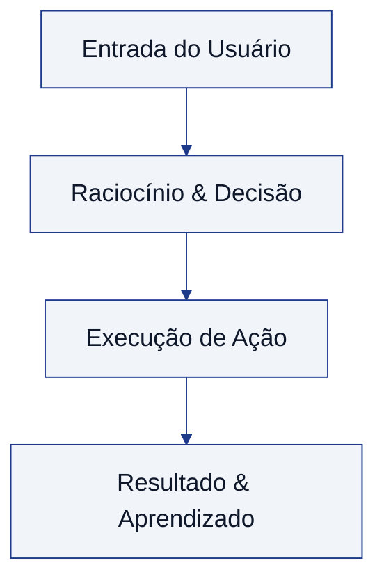

# Midia Dbaocm Hotmart Club Dia 1

> **Programa:** Imersão Oracle Database com IA — G. A. R de Brito Educacao
> **Módulo:** 02-gravacoes-e-praticas-avancadas
> **Status:** 🟡 Rascunho / Em Estruturação
> **Arquivo Base:** `midia-dbaocm-hotmart-club-dia-1.txt`

---

## 🎯 Objetivos de Aprendizagem
- Compreender os fundamentos apresentados em `Midia Dbaocm Hotmart Club Dia 1`.
- Relacionar com as práticas e arquiteturas do módulo `02-gravacoes-e-praticas-avancadas`.
- Aplicar conceitos práticos demonstrados nas aulas ao vivo e gravações
- Integrar fluxos de banco de dados com recursos de IA
- Diagnosticar e solucionar problemas comuns reportados na comunidade

---

## 🧠 Conceitos Fundamentais e Arquitetura

<!-- SÍNTESE BASEADA NA TRANSCRIÇÃO:
trabalho na área de TI vai fazer uns 10 anos mais ou menos
eu entrei ali como suporte de TI fazendo as coisas básicas
aí fui escalonando, cheguei a fazer minha faculdade
comecei a brincar um pouco com programação
mas não era uma coisa que eu gostava muito
e na faculdade eu já via que eu podia muito bancos de dados
mas a vida sempre foi levando com um caminho diferente
então sempre fui para a programação
até que uma coisa que eu gostava muito
a gente era mais surpresa nos atras parou
acabou, não, eu guei por mais me cheio com programação
porque eu não gosto conhecia Abel LCM
comecei a ingressar na carreira de bancos de dados
não sabia diferenciar data file de table space
pra mim é tudo a mesma coisa
-->

### Diagrama Arquitetural / Fluxo Conceitual

---

## 💻 Implementação Prática & Componentes Técnicos
- **Ferramentas abordadas:** Ver transcrição em `materiais/transcricoes/midia-dbaocm-hotmart-club-dia-1.txt`.
- **Implementações sugeridas:** Criar laboratório prático em `labs/`.

---

## ⚖️ Trade-offs e Gotchas
- **Atenção:** Documento gerado em modo scaffold offline. Configure a `GEMINI_API_KEY` para síntese automatizada com IA.

---

## 📌 Principais Conclusões
- Nota estruturada pronta para detalhamento técnico.
